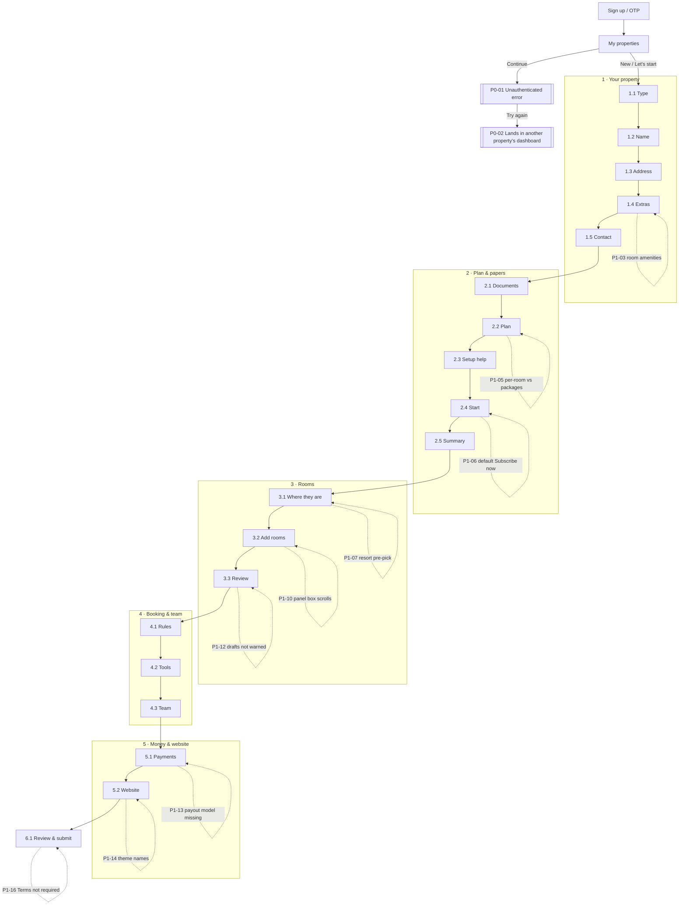

# Live HMS onboarding — QA notes

- **Target:** https://hms.bingi.app/onboarding (developer build, live)
- **Compared against:** BinGi onboarding v8 prototype (`main` of this repo; preview artifact `STWeLymPk5CtiyE4Zvyav7`)
- **Run:** 24 Nov 2026 · tester: Claude with Nazmul · desktop Chrome 1568 px
- **Test property:** "QA Test Resort" (Resort · Cox's Bazar · Ultra 30 rooms · "Set up first")
- **Rules kept:** no payment, no checkout page opened, no NID upload, no Terms ticked, **Submit not pressed**.

Severity: **P0** blocks the owner · **P1** wrong, confusing or differs from the agreed v8 behaviour · **P2** polish.

---

## Founder decisions (24 Nov 2026)
- **Pricing:** the 22 Nov model is final — per room per month (Starter ৳25 · Business ৳70 · Ultra ৳116; 6 mo 23/63/105; 12 mo 19/53/87), minimum 1 room, capacity = purchased rooms. No 30/50/100/200 packages.
- **KYC and room types — option (a):** owners can save as many room-type drafts as they need during onboarding. KYC gates only website publishing, online booking and payouts. → backend: drop `KYC_TRIAL_CATEGORY_LIMIT` for onboarding drafts.
- **KYC and subscription:** owners can pay the subscription before KYC. KYC gates online *guest* payments only. → backend: allow subscription checkout without KYC (fixes P0-05).
- Testing server `hms.bingi.app` may be tested freely (no real money, no real IDs).

## 0. Summary

| Area | Verdict |
|---|---|
| Overall look & step order | ✅ Same 6 parts and steps as v8; panel, live drawing, drafts, custom kind are in |
| Session / entry | ❌ P0 — Continue from *My properties* fails "Unauthenticated" |
| Accommodation categories | ❌ **P0 — only the first room type saves: backend `KYC_TRIAL_CATEGORY_LIMIT` (403) before KYC, shown as a generic error** |
| Category details | ⚠️ Works for the first type; fees shown at Starter rates on Ultra; duplicate unit codes across blocks |
| Subscription checkout | ❌ P0 — checkout says Ultra but URL is `PLAN_ENTERPRISE`; payment blocked by KYC after the flow offered "Subscribe now" |
| Plan / payment | ⚠️ "Pay per room" headline but package prices; default = Subscribe now; online-payment copy misses the BinGi balance → payout model |
| Website step | ⚠️ Wrong theme names (not NEST/CITY/ESCAPE/GRAND), empty thumbnails, no "How guests book" |
| Finish | ⚠️ Says "everything needed is done" without Terms; raw `NOT_SUBMITTED`; 2 different progress numbers |

Count: **5 × P0 · 18 × P1 · 21 × P2** (updated after the checkout run — section 2b)

---

## 1. Flow map — where each problem sits



Plain text:

```
My properties ─ Continue ─▶ ✖ Unauthenticated (P0-01) ─ Try again ─▶ other property's dashboard (P0-02)

1 Property ── Extras = room amenities (P1-03)
2 Plan ────── "pay per room" but packages (P1-05) · default Subscribe now (P1-06)
3 Rooms ───── Resort pre-picks only Rooms (P1-07)
              Room type #1 saves ✔ · type #2… ✖ 403 KYC_TRIAL_CATEGORY_LIMIT shown as generic error (P0-03)
              fees at Starter % on Ultra (P1-08) · C1 allowed in 2 blocks (P1-09) · panel box scrolls (P1-10)
              Review hides 4 unfinished drafts (P1-12)
5 Money ───── no "money comes to BinGi balance → payout" (P1-13)
  Website ─── themes "Classic Stay / Compact Business / BinGi Nest", empty images (P1-14) · no "How guests book" (P1-15)
6 Finish ──── "everything needed is done" without Terms (P1-16) · NOT_SUBMITTED raw (P2)
```

---

## 2. P0 — blockers

### P0-01 · Continue on *My properties* → "Could not load onboarding. Unauthenticated."
- **Steps:** /onboarding → My properties → "cvbdfgdfgd" (Resort, next "Where they are") → **Continue**.
- **Seen:** list loads (user is signed in for that call), then the onboarding load returns *Unauthenticated*.
- **Impact:** an owner who stopped half-way cannot come back.
- **Expected (v8):** Continue opens the saved step; if the session really expired → sign-in → back to the same step.
- **Dev hint:** list and onboarding bootstrap likely use different auth (cookie vs bearer / different scope).

### P0-02 · "Try again" opens a different property's dashboard
- **Seen:** `/dashboard/setup-center` of "Pan Pacific Sonargaon Dhaka" (10 / 13 steps), not the property being continued.
- **Impact:** wrong-property context; owner may edit the wrong hotel.
- **Expected:** retry the same property, or sign-in and return to it.
- **To confirm:** whether that property belongs to the same login (phone shown on *My properties* and on the account row differed).

### P0-03 · Only the **first** accommodation type can be saved — backend KYC limit, hidden from the owner
- **Steps:** 3.2 Add rooms → first type saves ✔ → any next type (Garden Cottage, Private Villa, 2-Bedroom Apartment, Suite; and on a fresh *Hotel* property a 2nd room type "Twin Room") → **Save**.
- **Root cause (captured in the page, 24 Nov):**
  ```
  POST https://api.bingi.app/api/onboarding/accommodation-categories  → 403
  {"code":"KYC_TRIAL_CATEGORY_LIMIT","message":"Accommodation category draft cannot be saved."}
  ```
  The backend allows **1 category before KYC**. Reproduced on 2 properties (Resort / Ultra, Hotel / Business).
- **Seen in the UI:** only the generic message, above the fold; panel stays open; no hint that NID would unlock it.
  Meanwhile 2.1 Documents says "You can continue setup meanwhile" and offers *Do it later*.
- **Impact:** a resort cannot add cottages or villas, a hotel cannot add its 2nd room type — exactly what onboarding is for.
- **Fix — founder decision needed:**
  - **(a, recommended)** lift the limit for *drafts* during onboarding (KYC still gates publishing, online booking and payouts), or
  - **(b)** keep the limit, but say it: "Upload your NID to add more room types" + button to Documents, shown *before* the owner fills the form; and make Documents required when the property has more than one kind.
- **Also:** map every API `code` to a plain sentence (KYC_TRIAL_CATEGORY_LIMIT, NOT_SUBMITTED…).

---

## 2b. Checkout & session run (24 Nov, after "test freely on the testing server")

### P0-04 · Checkout sells a different plan than the one shown
- **Steps:** 2.4 Start → Subscribe now → Go to checkout.
- **Seen:** page says **BinGi Ultra · BDT 3,500**, URL is `/onboarding/subscription-checkout?plan=PLAN_ENTERPRISE&return_to=onboarding`.
- **Impact:** the gateway order may be created for Enterprise while the owner agreed to Ultra.
- **Expected:** one plan id end to end; checkout shows plan, rooms, period and per-room price.

### P0-05 · Payment blocked by KYC at the very end
- **Steps:** checkout → **Continue to secure payment**.
- **Seen:** red bar "Complete hotel KYC verification to access this HMS module." — no gateway, no way forward.
- **Why it's P0:** the flow pre-selects *Subscribe now* and lets Documents be "Do it later", then refuses payment.
- **Expected (pick one, founder):** (a) allow subscription payment before KYC (KYC gates online *guest* payments only), or (b) hide/disable *Subscribe now* until documents are approved and say why on 2.4.

### P1-17 · Checkout summary wrong for a monthly plan
- "BinGi Ultra · **One-time activation** · BDT 3,500" — it is a monthly subscription; no room count, no period, no per-room line.
- "Owner: —" empty in Billing contact.
- Expected (22 Nov pricing): `Ultra · 5 rooms × ৳116 = ৳580 / month` (or 6 / 12-month rate), setup help line, total.
- "This HMS module" in the KYC message is developer wording.

### P1-18 · "Save & exit" signs the owner out
- **Seen:** Save & exit → `/login` ("Welcome back").
- **Expected:** save → *My properties* (or HMS dashboard) while staying signed in.

### ~~P1-19~~ withdrawn · Business lists "Restaurant / meal management (limited)"
- This is correct. The 11 Nov 2026 decision put Restaurant in Business as a limited version; Ultra has the full version.

### Confirmed on a 2nd property (QA Test Hotel · Business)
- Hotel → Business recommended ✅ · Rooms pre-picked + Apartments + "More kinds" ✅ · Area guessed from the road text ("Banani") ✅
- P1-08 again: Business shows −1.5 % / −12 % (should be −1 % / −8 %) → fees are always Starter's.
- Business package shows "5 of 20 rooms in your package" (`max_units: 20`) — package model, not the 22 Nov per-room model.

### Property types (plan helper on 2.2)
| Helper tile | Recommends | v8 | |
|---|---|---|---|
| Home / flat | Starter | Starter | ✅ |
| Guest house | Starter | Starter | ✅ |
| Hotel | Business | Business | ✅ |
| Resort | Ultra | Ultra | ✅ |
| Hotel group | Custom | Enterprise/custom | ✅ |
- Hostel, Motel, Serviced apartment, Lodge, Vacation rental and Other have no helper tile of their own.
- After the property type is changed (Hotel → Guest house), the plan helper still shows "Hotel" and "What you rent" does not re-suggest. → P2
- Changing the property type after setup turns *Booking & team* and *Money & website* grey again, without a warning. → P2
- Onboarding has no way back to *My properties* and no way to start a 2nd property. → P2
- Multi-type tests per property type are blocked until the KYC draft limit is lifted on the test account (it was still active at 11:50).

### More P2
17. Resume lands on a different step each time (3.1 after reload on 3.2; 5.2 after reload on 2.4 checkout).
18. Responsive check could not be done from the desktop browser (window is full-screen) — run on a phone or DevTools device mode.

---

## 3. P1 — wrong or different from v8

| ID | Step | Problem | Expected (v8 / decisions) |
|---|---|---|---|
| P1-01 | All | Progress stays **0 %** through all of part 1, then jumps by part (26 → 32 → 42 → 47 → 53 …) | Moves with each step |
| P1-02 | 1.x – 5.x | Right column still shows **"What guests will see" website preview** | Removed on 23 Nov; 3.1 shows the live drawing only |
| P1-03 | 1.4 Extras | Top list is **room** amenities (AC, bathtub, shampoo, hair dryer, King bed…); Wi-Fi / Pool only via search | Property facilities first: Free Wi-Fi, Parking, Power backup, 24-h desk, Restaurant, Room service, CCTV, Elevator, Breakfast, Airport transfer + Resort: Pool, Beach, Garden |
| P1-04 | 1.4 Extras | Search "wifi" finds nothing (item is "Wi-Fi") | Ignore hyphens/spaces/case |
| P1-05 | 2.2 Plan | Headline **"Pay per room. Nothing hidden"** but prices are **packages** (Starter ৳500 up to 30 rooms; Ultra 30/50/100/200 = ৳3,500 / 4,999 / 7,999 / 14,999) | **FINAL (founder, 24 Nov): the 22 Nov model.** Per room per month — Starter ৳25 · Business ৳70 · Ultra ৳116 (6 mo 23/63/105 · 12 mo 19/53/87), **minimum 1 room**, capacity = purchased rooms (no 30/50/100/200 packages). Room count step = number of rooms, quote = rooms × price |
| P1-06 | 2.4 Start | **"Subscribe now" pre-selected**, button "Go to checkout" | Default "Set up first"; trial / subscribe are options |
| P1-07 | 3.1 Where | Resort pre-picks **only Rooms** although it says "Suggested for your property type" | Resort → Rooms + Cottages + Villas |
| P1-08 | 3.2 Price table | On **Ultra**, fees shown as Website −1.5 % / Marketplace −12 % (Starter rates) → owner sees wrong earnings | Use the selected plan: Ultra 0.5 % / 4 % |
| P1-09 | 3.2 Numbers | Same code range **C1–C100 / V1–V100 in every block**; C1 can be picked in Lake Side *and* Block 2 | Codes unique per property (or block prefix — open decision "Z1-C1") |
| P1-10 | 3.2 Panel | After Save fails, the **panel box itself scrolls** (dialog scrollTop 367): footer floats mid-panel, blank area below | Only the panel body scrolls (fixed in prototype 23 Nov) |
| P1-11 | 3.2 Panel | Error is one generic line and **hidden above the fold**; no reason given | Show the reason at the top of the visible area |
| P1-12 | 3.3 Review | 4 unfinished drafts (Cottage, Villa, Apartment, Suite) **not mentioned**; "Finish room setup" allowed | Warn: "4 types not saved — finish or discard" |
| P1-13 | 5.1 Payments | Online payment copy misses **how money flows** (SSLCommerz / EPS → BinGi balance → payout on request) and marketplace | v8 copy (22 Nov "Payments via BinGi") |
| P1-14 | 5.2 Website | Themes named **Classic Stay / Compact Business / BinGi Nest**, thumbnails empty | NEST · CITY · ESCAPE · GRAND with real previews; Resort → ESCAPE first |
| P1-15 | 5.2 Website | No **"How guests book"** choice (request only / pay at hotel / pay online) | 22 Nov decision |
| P1-16 | 6.1 Finish | "Everything needed to submit is done" while **Terms & Privacy not accepted** (Documents step says all three are needed before submit) | Submit blocked until the 3 confirmations are ticked |

---

## 4. P2 — polish

1. 1.1 — Big types (hotel/resort/motel/lodge) don't open **star rating + one-line about** on the type step (v8 round 3 #1); star rating sits on 1.5 Contact.
2. 1.3 — City list is grouped by division without labels; no search; Dhaka is far down.
3. 1.4 — All amenity icons are the same sparkle; "Air Conditionin-g" wraps mid-word.
4. 2.2 — Ultra card "Includes" list is the same as Business; Ultra's extras (Restaurant, Full HRM, Inventory) only in the top box.
5. 2.2 — Plan cards don't show Team (Business) vs Full HR (Ultra) — 23 Nov decision.
6. 2.4 — With "Set up first" the summary says **"Monthly after trial"**.
7. 2.5 — "Your subscription and setup service are ready" although nothing was subscribed.
8. 2.4 — Trial is **30-day**; ads say 7-day (open decision).
9. 3.2 — Panel is ~58 % wide; v8 ≈ 88 % (max 1120 px) on desktop.
10. 3.2 — Cottage / villa / apartment forms say "Room numbers" and placeholder "e.g. Ocean View Deluxe".
11. 3.2 — Villa / apartment have no bedrooms / bathrooms fields (v8 presets carry them) — *to confirm in v8 form*.
12. 3.2 — Row shows **"Ready"** and **"Waiting for BinGi approval"** together.
13. 3.2 — "100 available" doesn't drop after picking numbers.
14. 3.x — Reload returns to 3.1 instead of the step you were on.
15. 4.2 — Tool names still old (Staff & roles, Restaurant & meals, Other services) — v7 names are 23 Nov.
16. 6.1 — Raw `NOT_SUBMITTED`; "Fix" on optional items; ring 71 % vs sidebar 89 %; developer text "eligible legacy Room inventory"; Money & website not ticked Done in the sidebar.

---

## 5. Matches v8 ✅ (keep)

- 6 parts / step names, sidebar with sub-steps, Save & exit, Help, Bangla/English switch.
- Contact: verified mobile, optional business details.
- Documents: NID both sides, optional papers, "Do it later".
- Setup help with prices; summary with "Change" links.
- 3.1: What you rent / Building & floors / Zones-Blocks with own names / numbering letters per kind / **custom kind with quick picks** / **live drawing** (floors, blocks, names update live) / "Has rooms — can't remove".
- 3.2: one-type panel with section nav, category presets per kind, price breakdown, floor/zone number picker (+5 / +10 in a row, own code), unfinished drafts kept and shown with Continue.
- 4.x: booking rules prefilled; tools per plan; team optional.
- 5.1: cash always on; bKash/Nagad/Rocket with number, account type, guest instructions; payout "add now / later".

---

## 6. Not tested yet

| # | What | Why |
|---|---|---|
| 1 | Payment gateway page | Blocked by KYC (P0-05) |
| 2 | **Phone** layout (390 px) | Next run |
| 3 | Hotel, Guest house, Serviced apartment, Hostel, Home/flat, Lodge, Motel, Vacation rental, Other **as property type** (pre-picks, floors vs zones) | Each needs a new property; blocked on P0-03 for multi-type checks |
| 4 | Submit + what happens after | Needs Terms acceptance by the owner |
