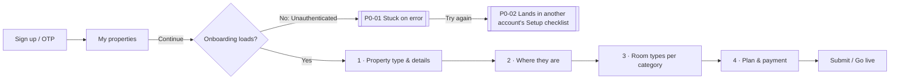

# Live HMS onboarding — QA notes

- **Target:** https://hms.bingi.app (developer build, live)
- **Compared against:** BinGi onboarding v8 prototype (this repo, `src/components/onboarding/*`)
- **Started:** 24 Nov 2026 · tester: Claude (with Nazmul)
- **Rules:** view and test only. No payment, no card/password entry, nothing irreversible without the founder's OK.

Severity: **P0** blocks the owner · **P1** wrong or confusing · **P2** polish / mismatch with v8.

---

## 1. Flow map (where each problem sits)



Plain-text version:

```
Sign up ─▶ My properties ─▶ Continue ─▶ [ERROR: Unauthenticated]  ← P0-01
                                             │ Try again
                                             ▼
                              Setup checklist of a DIFFERENT account  ← P0-02
```

---

## 2. Problems found

### P0-01 · "Continue" on My properties fails: "Could not load onboarding. Unauthenticated."
- **Where:** /onboarding → My properties → property "cvbdfgdfgd" (Resort, next step "Where they are") → **Continue**
- **What happens:** the list loads (so the user *is* seen as signed in), but opening the property shows
  `Could not load onboarding. Unauthenticated.` with a **Try again** button.
- **Why it matters:** an owner who left setup half-way cannot come back to it. Dead end on day one.
- **Likely cause (to check):** My-properties list and the onboarding API use different auth (cookie vs token, or different
  session scope). The list call succeeds, the onboarding bootstrap call returns 401.
- **Expected (v8):** Continue opens the property on its saved step. If the session really expired → sign-in screen,
  then back to the same step — never a dead-end error.

### P0-02 · "Try again" sends the user into a different account's dashboard
- **Where:** same error box → **Try again**
- **What happens:** lands on `/dashboard/setup-center` signed in as another owner ("Pan Pacific Sonargaon Dhaka",
  10 of 13 setup steps) — not the property the user was continuing.
- **Why it matters:** wrong-account context = privacy and data-safety risk; the user may edit the wrong hotel.
- **Expected:** Try again retries the same property; if auth is missing → sign-in, then back to that property.

---

## 3. Checks still to run (after a fresh registration)

| # | Area | Check against v8 | Status |
|---|---|---|---|
| 1 | UX/UI overall | Layout, copy, steps, Bangla/English, mobile | ⏳ |
| 2 | Property type | Type asked once; big types (hotel/resort/motel/lodge) get star + about | ⏳ |
| 3 | Where they are | Buildings, floors, ground, basements, zones/blocks, names | ⏳ |
| 4 | Categories | Every accommodation type: Room, Cottage, Villa, Apartment, Custom | ⏳ |
| 5 | Category details | Name, guests, bed, size, price + VAT/service, numbers, photos, amenities, meals | ⏳ |
| 6 | Payment | Plan step, How guests book, BinGi balance/payout copy vs current UI | ⏳ |
